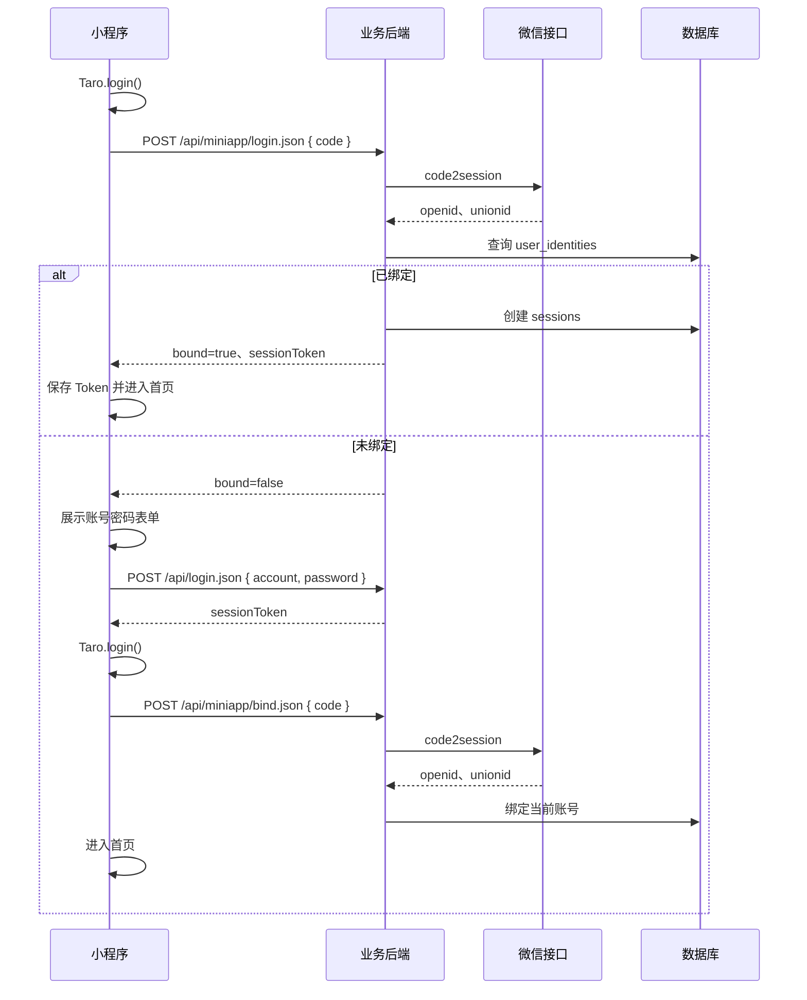

# 小程序微信授权登录方案

## 1. 目标

小程序保留账号密码登录，并使用微信 `openid` 提供后续免密登录。

- 用户首次通过账号密码登录成功后，小程序调用 `Taro.login()`，由后端使用 `code2session` 获取 `openid` 并绑定当前账号。
- 用户再次打开 `/login` 页面时，小程序先调用 `Taro.login()` 发起免密登录。
- 已绑定账号直接建立会话并进入工作台。
- 未绑定账号展示账号密码表单。
- 用户可在“我的”页面查询绑定状态并解绑微信。

首期不为小程序自动创建工作台账号，角色和权限仍由现有账号体系维护。

## 2. 登录流程



微信临时 `code` 只能使用一次。客户端在 `MINIAPP_WECHAT_CODE_INVALID` 时重新调用一次 `Taro.login()`，不会循环重试。

## 3. 后端接口

### 3.1 微信免密登录

```http
POST /api/miniapp/login.json
X-Client-Type: miniapp
Content-Type: application/json

{ "code": "微信临时 code" }
```

未绑定：

```json
{
  "success": true,
  "data": { "bound": false }
}
```

已绑定：

```json
{
  "success": true,
  "data": {
    "bound": true,
    "sessionToken": "...",
    "needModifiedPwd": false
  }
}
```

后端只从微信接口获取 `openid` 和可选的 `unionid`，不接受客户端传入。命中的身份必须启用，关联账号也必须启用。

### 3.2 绑定当前账号

```http
POST /api/miniapp/bind.json
Authorization: Bearer <账号密码登录得到的 Token>
X-Client-Type: miniapp
Content-Type: application/json

{ "code": "微信临时 code" }
```

该接口要求有效会话。微信身份已绑定其他账号时返回 `409 MINIAPP_IDENTITY_CONFLICT`；身份已停用时返回 `403 MINIAPP_IDENTITY_DISABLED`。同一身份重复绑定到当前账号是幂等操作。

### 3.3 查询绑定状态

```http
GET /api/miniapp/binding.json
Authorization: Bearer <Token>
```

返回：

```json
{
  "success": true,
  "data": { "bound": true }
}
```

### 3.4 解绑微信

```http
DELETE /api/miniapp/binding.json
Authorization: Bearer <Token>
```

解绑只删除当前小程序 AppID 下、当前账号的微信身份，不删除工作台账号，也不注销其他已有会话。再次登录时 `POST /api/miniapp/login.json` 会返回 `bound=false`。

## 4. 数据模型

绑定关系保存在 `user_identities`：

| 字段 | 说明 |
| --- | --- |
| `user_id` | 工作台账号 ID |
| `provider` | 固定为 `wechat_miniapp` |
| `app_id` | 微信小程序 AppID |
| `openid` | 当前小程序内的微信身份 |
| `unionid` | 微信开放平台跨应用身份，可为空 |
| `status` | 身份是否启用 |
| `last_login_at` | 最近一次微信免密登录时间 |

唯一约束为 `provider + app_id + openid`，确保一个微信身份不能同时绑定多个工作台账号。`openid` 和 `unionid` 不返回小程序页面，也不参与权限计算。

## 5. 小程序页面

### 5.1 登录页

页面进入时先检查本地会话。没有会话时调用微信免密登录：

- `bound=true` 时保存 Bearer Token，按 `needModifiedPwd` 跳转首页或强制改密页。
- `bound=false` 时展示账号密码表单。
- 微信服务不可用时仍展示账号密码表单，避免阻断正常登录。

账号密码登录成功后，小程序再次调用 `Taro.login()` 并绑定当前微信。绑定失败时账号登录仍可继续，同时明确提示用户本次微信绑定未完成。

### 5.2 我的页面

“我的”页面通过绑定状态接口展示当前微信是否已绑定，并提供带确认弹窗的“微信解绑”操作。解绑成功后立即刷新页面状态。

## 6. 开发配置

后端环境变量：

```dotenv
WECHAT_MINIAPP_APP_ID=当前小程序 AppID
WECHAT_MINIAPP_APP_SECRET=当前小程序 AppSecret
```

`AppSecret` 只能保存在后端 `.env` 或部署平台的密钥环境中，不能写入小程序环境文件、前端代码或构建产物。

> [!IMPORTANT]
> 当前仓库开发环境中的 AppSecret 属于“深维”产品。开发其他小程序时，必须先从微信公众平台获取该小程序自己的 AppID 和 AppSecret，并同时替换后端两项配置，禁止跨产品复用。

## 7. 安全与验证

- 微信登录和绑定都通过服务端 `code2session` 换取身份，客户端不能直接提交 `openid`。
- 绑定接口必须通过现有会话认证。
- 密码登录继续沿用现有失败次数、锁定时间和账号停用规则。
- 微信身份冲突时不能自动转移绑定，必须先解绑再重新绑定。
- 后端测试覆盖未绑定、绑定、免密登录、解绑、身份冲突和未登录访问。

验证命令：

```bash
cd backend
npm run typecheck
npm test

cd ../miniapp
npm run typecheck
npm run build:weapp
```
